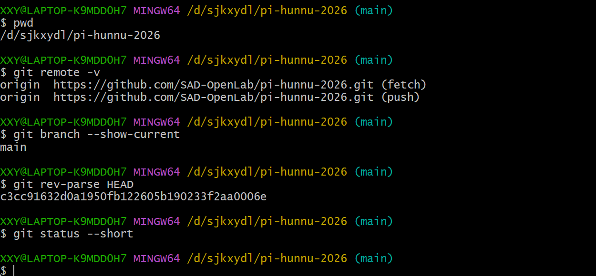
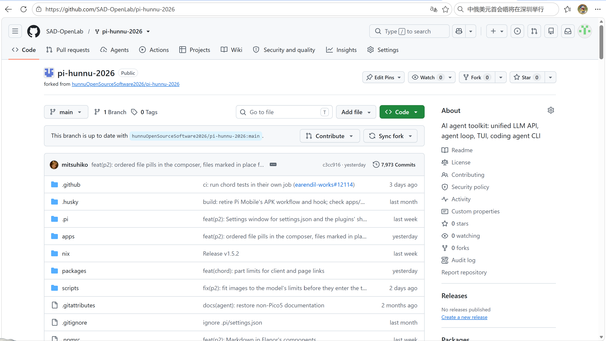
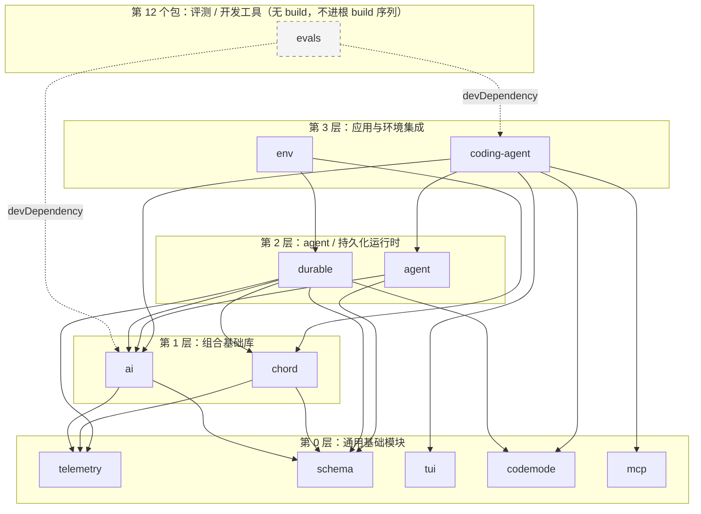

## 截图（S1：本地源码与仓库信息）





# pi-hunnu-2026 模块与构建分析

分析范围：当前工作区 `packages/` 下实际存在的全部 12 个包；按源码、README、`package.json` 和 TypeScript 构建配置核对。这里的“直接依赖”指包清单中直接声明的其他本仓库包，并区分生产 `dependencies` 与开发 `devDependencies`；不把源码示例、传递依赖或外部库算作内部模块依赖。

## 源码获取与仓库信息

当前 checkout 的 Git 信息：

| 项目 | 当前工作区信息 |
|---|---|
| `origin` | `https://github.com/SAD-OpenLab/pi-hunnu-2026.git` |
| 分支 | `main` |
| 当前提交 | `c3cc91632d0a1950fb122605b190233f2aa0006e` |
| 本地源码目录 | `D:\sjkxydl\pi-hunnu-2026` |


## 模块分析表

| 子文件夹 | 代码主要实现什么功能 | 本模块 `build` 执行什么、生成什么 | 直接依赖哪些内部模块 | 依据文件或代码位置 |
|---|---|---|---|---|
| `telemetry` | 提供后端无关的遥测契约：span、事件、metrics、上下文传播、无操作及内存参考实现，并以类型描述遥测 schema。 | `tsc -p tsconfig.build.json`，编译 `src/` 到 `dist/`；按根 TS 配置生成 JS、声明文件及 source/declaration maps。 | 无。 | `packages/telemetry/README.md`；`src/index.ts`、`src/memory.ts`、`src/metrics.ts`；`package.json`、`tsconfig.build.json` |
| `schema` | 构造 JSON Schema，并编译为不依赖 `eval` 的验证函数；提供 drafts 2020-12/7 的校验、类型推导和错误报告。 | `tsc -p tsconfig.build.json`；生成 `dist/` 中的模块 JS、`.d.ts` 及映射文件。 | 无。 | `packages/schema/README.md`；`src/index.ts`、`src/builders.ts`、`src/validator.ts`、`src/compiler.ts`；`package.json`、`tsconfig.build.json` |
| `chord` | 跨进程对象运行时：定义契约、host、facet、document、store、link、jobs、plugins，以及 Node、Web、React、TUI 等子路径 API。 | `tsc -p tsconfig.build.json`；把 `src/` 的模块及声明编译到 `dist/`。 | `schema`、`telemetry`。另有可选的**外部** peer dependencies：`esbuild`、`react`、`ws`，不是内部模块依赖。 | `packages/chord/README.md`；`src/index.ts`、`src/contracts/`、`src/host/`、`src/store/`；`package.json`、`tsconfig.build.json` |
| `tui` | 提供终端 UI 框架：组件、输入编辑、布局、主题和增量渲染等，用于交互式 CLI。 | `tsc -p tsconfig.build.json` 编译 TS 源码到 `dist/`。平台 native 构建另由 `build:native:darwin/linux/win32` 执行，不是本包普通 `build` 的步骤。 | 无。 | `packages/tui/README.md`；`src/index.ts`、`src/components/`；`package.json`、`tsconfig.build.json` |
| `codemode` | 在 QuickJS/WASM 沙箱中运行模型生成的 JavaScript，只通过注入工具提供能力；包括本地、inline 与远程/Cloudflare 运行路径。 | `tsc -p tsconfig.build.json` 编译 `src/` 到 `dist/`；QuickJS/WASM runtime 由 `quickjs-wasi` 依赖提供，不是此 `build` 脚本编译出来的。 | 无。 | `packages/codemode/README.md`；`src/index.ts`、`src/runtime/`、`src/wasm.ts`；`package.json`、`tsconfig.build.json` |
| `mcp` | 独立 MCP 客户端库：管理协议会话和 JSON-RPC 请求，提供 stdio、pipe、Streamable HTTP 传输、OAuth 及工具/资源适配。它不是 MCP 服务端。 | `tsc -p tsconfig.build.json` 编译 `src/` 到 `dist/`，输出分模块 JS、类型声明和映射文件。 | 无。README 中与 `pi-env`、`pi-ai`、`pi-agent-core` 的组合示例是调用方集成，不是此包的生产依赖。 | `packages/mcp/README.md`；`src/index.ts`、`src/client.ts`、`src/transports/`、`src/oauth/`；`package.json`、`tsconfig.build.json`、`packages/mcp/模块分析报告.md` |
| `ai` | 统一多供应商 LLM API：模型/Provider、流式请求、认证、工具调用、图像能力、OAuth 和模型目录。 | `build` 先运行 `generate-models`，再运行 `build:offline`；后者检查模型数据、用 `tsc` 编译到 `dist/`，清理并复制 `src/providers/data` 到 `dist/providers/data`。`build:offline` 不执行模型生成。 | `schema`、`telemetry`。 | `packages/ai/README.md`；`src/index.ts`、`src/api/`、`src/providers/`、`catalog/generate.ts`；`package.json`、`tsconfig.build.json` |
| `durable` | 持久化 agent harness：对话、模型轮次、工具调用和文档状态写入存储，支持恢复、调度、工具、任务图和上下文管理。 | `tsc -p tsconfig.build.json` 编译到 `dist/`；其 TS paths 映射要求 `chord`、`ai` 等依赖的 `dist` 声明已存在。 | `chord`、`ai`、`codemode`、`schema`、`telemetry`。 | `packages/durable/README.md`；`src/index.ts`、`src/harness/`、`src/storage/`；`package.json`、`tsconfig.build.json` |
| `env` | 提供 Durable 执行环境接口的本地/远程适配：SSH 连接、文件/命令/进程、PTY、文件监视；Rust daemon 通过分帧协议在远端执行操作。 | 普通 `build` 运行 `tsc -p tsconfig.build.json`，编译 TS 到 `dist/`。Rust daemon 是单独的 `build:daemon`（`cargo build --manifest-path daemon/Cargo.toml --locked`），不由普通或根 `build` 自动执行。 | `chord`、`durable`。 | `packages/env/README.md`；`src/index.ts`、`src/remote-env.ts`、`src/connection.ts`、`src/ssh.ts`；`daemon/src/output.rs`；`package.json`、`tsconfig.build.json`、`packages/env/模块分析报告.md` |
| `agent` | 提供不绑定具体传输层的通用 agent：状态管理、消息转换、工具执行、事件流和代理/流式接口。 | `tsc -p tsconfig.build.json` 编译 `src/` 到 `dist/`；`tsconfig.build.json` 通过 paths 引用已构建的 `ai` 声明。 | `ai`、`schema`。 | `packages/agent/README.md`；`src/index.ts`、`src/agent.ts`、`src/agent-loop.ts`、`src/types.ts`；`package.json`、`tsconfig.build.json` |
| `coding-agent` | 面向用户的 Pi CLI/编码 agent：会话、工具、扩展、交互式 TUI、RPC 和命令行入口；组合下层 agent、模型和 UI 能力。 | `build` 先运行 `build:unbundled`（TS 编译、设置 CLI/RPC 可执行位、复制主题/图片/HTML assets），再运行 `scripts/build-coding-agent-bundle.mjs` 用 esbuild 产出 `dist/bundle/` 中的 CLI、SDK/RPC bundle、分块及 lazy/worker bundles。根 `build` 不运行额外的 Bun `build:binary`，因此不会生成独立 `dist/pi` 原生可执行文件。 | `agent`、`ai`、`codemode`、`mcp`、`tui`。 | `packages/coding-agent/README.md`；`src/index.ts`、`src/cli.ts`、`src/core/agent-session.ts`；`package.json`、`tsconfig.build.json`、`scripts/build-coding-agent-bundle.mjs` |
| `evals` | 内部评测包：运行 Pi coding-agent 行为 smoke/audit 测试及有/无文档的 Docker A/B 评测，整理成对运行结果；不是产品运行时库。 | **没有 `build` 脚本**，不会由本包生成 `dist/`。`eval:host`、`eval:audit`、`eval:docs`、`eval` 运行评测；其中 `eval:docs` 会构建两个评测 Docker 镜像并写入 `.eval/` 运行记录/报告，这不是 npm build。 | 开发依赖 `ai`、`coding-agent`（`devDependencies`），不是生产依赖。 | `packages/evals/README.md`、`package.json`；`src/cli.ts`、`src/docker.ts`、`src/harness.ts`、`src/report.ts`；`packages/evals/模块分析报告.md` |


## 本人重点分析模块及成果概述

本人重点分析 **`env`、`evals`、`mcp`**。

### `env`：远程执行与 daemon 输出调度

分析厘清了 TypeScript 客户端与 Rust daemon 的分工：客户端通过 SSH/Connection 提供 Durable 执行环境适配，daemon 在目标机执行文件、命令、进程和终端操作。重点源码 `daemon/src/output.rs` 是共享输出调度和背压层，而不是具体命令实现：它通过控制帧队列和批量数据队列集中写 stdout，优先发送控制帧；大响应和命令输出进入批量队列，并维持命令输出与结果的顺序。积压超过 4 MiB 时，`Gate` 暂停输出读取线程，队列下降后再唤醒，从而限制积压并将压力传回输出进程。构建结论是普通 `build` 只编译 TypeScript 客户端；Rust daemon 由单独的 `build:daemon` 编译。

### `evals`：隔离评测与文档效果对照

分析确认 `evals` 是用于验证 coding-agent 行为的内部评测工具，不是生产运行库。它通过隔离的工作区和 agent session 执行任务，收集 transcript、token/耗时等运行证据；文档 A/B 测试对同一场景构建 `with_docs` 与 `without_docs` 两种 Docker 镜像，要求两边 case 集合一致，再按模型和轮次配对比较。报告工具校验配对结果，遇到缺失或无效的一侧会阻断该 pair，而不是按零分处理。包本身没有 npm `build`；Docker 镜像构建是 `eval:docs` 评测运行流程的一部分。

### `mcp`：协议会话、传输和 OAuth

分析确认该包实现的是 MCP 客户端而非服务端。`McpClient` 负责初始化、协议版本协商、请求关联、超时/取消及工具和资源操作；`McpTransport` 抽象将会话逻辑与 stdio、调用方提供的 pipe、Streamable HTTP 传输分开，stdio/pipe 共用分行读取器。OAuth 子模块负责发现、PKCE 授权、令牌存储/刷新和分阶段登录；配置校验、工具命名、输入 schema 规范化及输出限额则帮助应用集成。构建由 `tsc -p tsconfig.build.json` 将 TS 模块编译为 `dist`，不打成单一 bundle；包没有直接的 Pi 内部生产依赖，README 中提到的其他 Pi 包是集成方选择。

## 构建顺序与依赖

根目录 `package.json` 的 `build` 脚本按下列顺序显式串行执行子目录命令；这不是 npm 自动根据依赖拓扑推导的执行顺序：

```text
telemetry → schema → chord → tui → codemode → mcp → ai → durable → env → agent → coding-agent
```

`build:offline` 顺序相同，仅把 `ai` 的 `npm run build` 换为 `npm run build:offline`。根目录脚本没有进入 `packages/evals`。根 `build` 也不先 `clean`；`clean` 只在其他明确调用它的脚本（如 `prepublishOnly`）中发生。根包没有用自身的 TS 配置编译一个根级产物。

相邻模块不一定互相依赖。下面列出根构建链每一对相邻项是否存在直接内部依赖（方向均为“使用方 → 被依赖方”）：

| 构建链相邻项 | 是否直接依赖 | 说明 |
|---|---:|---|
| `telemetry` → `schema` | 否 | 两者均无内部运行时依赖。 |
| `schema` → `chord` | 是 | `chord` 依赖 `schema`。 |
| `chord` → `tui` | 否 | `tui` 没有内部运行时依赖。 |
| `tui` → `codemode` | 否 | 两者在构建链中相邻，但没有直接依赖关系。 |
| `codemode` → `mcp` | 否 | 两者在构建链中相邻，但没有直接依赖关系。 |
| `mcp` → `ai` | 否 | `mcp` 没有 `ai` 的包级依赖。 |
| `ai` → `durable` | 是 | `durable` 依赖 `ai`。 |
| `durable` → `env` | 是 | `env` 依赖 `durable`。 |
| `env` → `agent` | 否 | `env` 不依赖 `agent`，`agent` 也不依赖 `env`。 |
| `agent` → `coding-agent` | 是 | `coding-agent` 依赖 `agent`。 |

有依赖的包先构建可提供下游 TS paths 所指向的 `dist/*.d.ts` 和 JS 入口。没有直接依赖的模块也被串行安排，反映的是根脚本选择的确定执行序列，不构成依赖证据。可从 `durable/tsconfig.build.json`、`agent/tsconfig.build.json` 和 `coding-agent/tsconfig.build.json` 中看到对前置包 `dist` 声明的路径映射。

### 模块层级与依赖图

层级按**内部直接依赖的有向图**划分，而非按根构建顺序或文件夹名称划分：第 0 层是没有内部运行时依赖的基础包；较高层的模块直接使用下一层或更低层的包。每条实线箭头均按“使用方 → 被依赖方”，来自 `dependencies`；不同层级之间允许有跨层依赖。

图中包含当前工作区的第 12 个包 `evals`。它不在根构建顺序内；`package.json` 将 `ai` 和 `coding-agent` 列为其开发依赖，因此以虚线表示开发期依赖。Chord 的可选 peer dependencies 是**外部**包，不属于本图内部模块边。



可单独编辑的 Mermaid 图源：[模块依赖图.mmd](模块依赖图.mmd)；此图也嵌入本报告，便于支持 Mermaid 的 Markdown 阅读器直接渲染。


## 当前版本与题目清单的差异

- 当前 `packages/` 有 **12 个直接子文件夹/包**：`telemetry`、`schema`、`chord`、`tui`、`codemode`、`mcp`、`ai`、`durable`、`env`、`agent`、`coding-agent`、`evals`。题目列出其中 11 个，漏列了 `evals`；因此上面的模块分析表和依赖图均已按实际包目录包含全部 12 个。
- 根 `build`/`build:offline` 显式串行构建前 11 个包，**不包含 `evals`**。`evals` 有 `test`、`eval:*` 脚本，没有 `build` 脚本；其 `eval:docs` 在运行评测时触发 Docker 镜像构建，这不改变根构建列表，也不等同于 `evals` 包的 npm build。
- `env` 有 Rust daemon，但 Rust 构建通过 `build:daemon` 单独启动；根构建仅运行 TypeScript `build`，不能据此推断 daemon 已重新编译。
- 普通 `coding-agent` build 生成 JS bundle；`build:binary` 是独立脚本，不能与根 `npm run build` 混为一谈。

## 结合分析回答

### 1. 根目录与子模块中的 `npm run build` 分别读取什么配置、执行什么工作？

根目录执行 `npm run build` 时，读取根 `package.json` 的 `scripts.build`。它不是一次根级 TypeScript 编译，也不是 npm 自动按依赖图排序，而是按脚本中写明的目录顺序逐个进入 11 个子包并运行各自的 `npm run build`。大多数子包的 build 脚本执行 `tsc -p tsconfig.build.json`；各自 `tsconfig.build.json` 再继承根 [`tsconfig.base.json`](tsconfig.base.json)，通常将 `src/` 编译到包自己的 `dist/`，生成 JavaScript、类型声明及映射文件。

子包的构建细节由它自己的 `package.json` 和配置决定：`ai` 还会生成模型目录、检查模型数据并复制 provider 数据；`coding-agent` 除 TS 编译外，还复制运行资源并调用 esbuild 生成 bundle。`evals` 没有 `build` 脚本，不在根构建链中。`env` 的 Rust daemon 需另行执行 `build:daemon`；`coding-agent` 的独立二进制需执行 `build:binary`。这些都不是根 `npm run build` 自动完成的工作。

### 2. 构建顺序和模块依赖有什么关系？相邻构建的模块是否一定互相依赖？

根构建顺序由根 `package.json` 明确串行写出：

```text
telemetry → schema → chord → tui → codemode → mcp → ai → durable → env → agent → coding-agent
```

顺序与依赖有关：需要其他包声明文件或输出的包通常排在依赖包之后，例如 `schema` 先于依赖它的 `chord`，`ai` 先于依赖它的 `durable`，`durable` 先于依赖它的 `env`。但顺序并非每一对相邻项都代表依赖。按“构建顺序中前项、后项”核对，相邻项中只有 `schema`/`chord`、`ai`/`durable`、`durable`/`env`、`agent`/`coding-agent` 存在前后项之间的直接依赖关系；`telemetry`/`schema`、`chord`/`tui`、`tui`/`codemode`、`codemode`/`mcp`、`mcp`/`ai`、`env`/`agent` 不直接互相依赖。`evals` 是第 12 个包，但没有 build 脚本，因此不在这条构建顺序中。

### 3. 依赖路径示例：`coding-agent → agent → ai`

此处箭头表示“使用方 → 被依赖方”。`coding-agent` 负责面向用户的 CLI、会话和工具编排；它调用 `agent` 提供的通用 agent 状态管理、上下文处理、流式调用和工具执行；`agent` 再使用 `ai` 提供的模型/provider 接入、认证与流式 API。这样，产品交互、通用 agent 运行时和模型服务适配各由对应模块负责，避免上层重复实现模型供应商协议。
